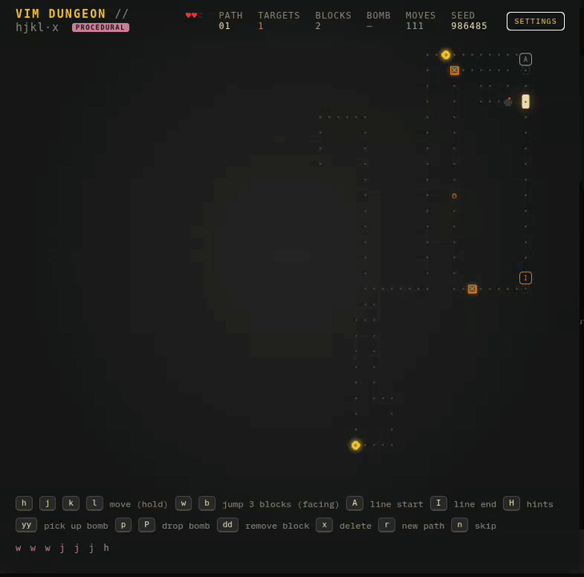

# Vim Dungeon

<p align="center">
  
</p>

Learn Vim motions by playing. Walk a winding path, destroy targets, and dodge Pac-Men.

**Live:** https://raspberrypi.ibex-mooneye.ts.net:10000/

> Implemented by DeepSeek and designed stage by stage in Linear. The game is fun to play, and most seeded paths are difficult.

## How to Play

- **Move:** `h j k l` along the path dots.
- **Destroy targets:** stand on an orange `o` and press `x`.
- **Avoid Pac-Men:** contact costs a heart.
- **Clear blockers:** face one and press `dd`.
- **Use bombs:** pick up with `yy`, drop with `p` or `P`. They explode after 3 seconds, destroying Pac-Men within 5 blocks.
- **Progress:** clear the path for a longer stage. Each stage adds one Pac-Man (max six) and 3-5 blockers.

## Run Locally

No build step or dependencies. Serve over HTTP, because ES modules don't work from `file://`.

```bash
cd game
python3 -m http.server 8080
```

Open [http://localhost:8080](http://localhost:8080).

## Controls

| Key | Action |
|---|---|
| `h` `j` `k` `l` | Move along the path |
| `w` / `b` | Jump forward/back up to 3 dots |
| `I` / `A` | Jump to line start/end |
| `x` | Delete target |
| `dd` | Remove blocker in front |
| `yy` | Pick up a bomb (one at a time) |
| `p` / `P` | Drop bomb on next/previous block |
| `H` | Toggle hints |
| `r` | New path, same stage |
| `n` | Skip to next stage |
| `Esc` | Close settings |

Movement and jumps can't cross gaps or blockers. Taking damage grants brief invulnerability, and losing all hearts restarts the path.

## Settings

Open **SETTINGS** (top right) to toggle hints or swap `I` / `A`. Both persist in `localStorage`.

You can also set the swap default with `?swap=1` in the URL or `swapStartEnd: true` in `src/config.js`.

## Tests

```bash
cd game
node --test
```

## Structure

```text
game/
├── index.html
├── src/
│   ├── main.js        # Boot, input, loop
│   ├── config.js      # Default settings
│   ├── layout.js      # Grid sizing
│   ├── core/          # RNG, path generation, game rules
│   ├── render/        # Canvas renderer
│   └── ui/            # HUD
├── styles/theme.css   # Gruvbox-inspired theme
└── tests/             # Path, game, ghost, bomb, block, boundary tests
```
