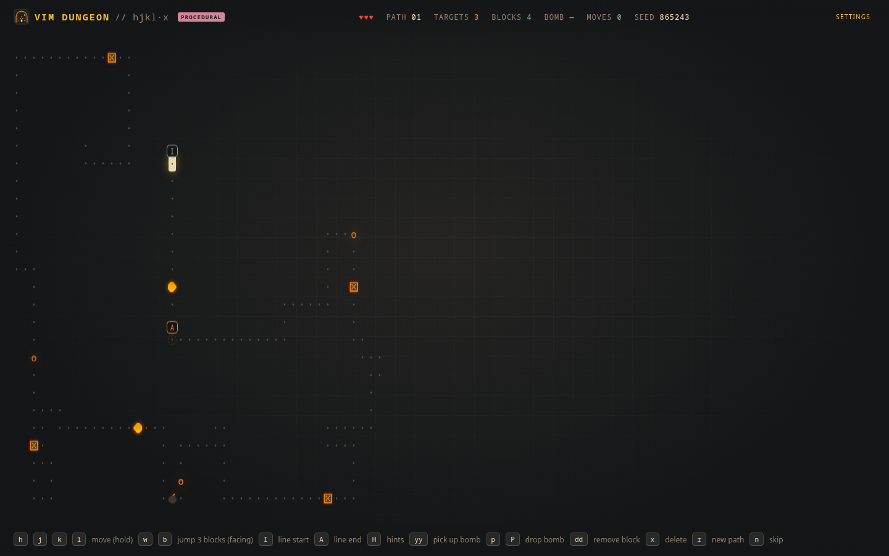

# Vim Dungeon
<p align="center">
  
</p>

## How to Play
> LIVE : https://raspberrypi.ibex-mooneye.ts.net:10002/

Each run generates a winding path with orange `o` targets to destroy. Navigate the path using Vim motions, avoid Pac-Men, and clear blockers to reach your objectives.

- **Move:** Use `h j k l` to move between adjacent path dots.
- **Destroy targets:** Stand on an orange `o` and press `x`.
- **Avoid enemies:** Pac-Men patrol the path and cost you a heart on contact.
- **Clear blockers:** Face a blocker and press `dd`.
- **Use bombs:** Pick up a bomb with `yy`, then drop it with `p` or `P`.
- **Progress:** Clear the path to generate a longer, more challenging stage.

Each new stage adds one Pac-Man, up to a maximum of six, along with 3–5 randomly placed blockers.

## Getting Started

Vim Dungeon uses plain JavaScript ES modules and Canvas. No build step or dependencies are required.

```bash
cd game
python3 -m http.server 8080
```

Open [http://localhost:8080](http://localhost:8080) in your browser.

> **Note:** The game must be served over HTTP. Opening `index.html` directly through `file://` will not work because ES modules require an HTTP server.

## Controls

### Movement

| Key             | Action                                             |
| --------------- | -------------------------------------------------- |
| `h` `j` `k` `l` | Move along the path in the corresponding direction |
| `w`             | Jump forward up to 3 contiguous path dots          |
| `b`             | Jump backward up to 3 contiguous path dots         |
| `I`             | Jump to the start of the current line              |
| `A`             | Jump to the end of the current line                |

Hold `h`, `j`, `k`, or `l` to keep moving. The last movement direction determines the direction used by `w` and `b`.

Jumps stop early if the contiguous path ends. Neither movement nor jumps can cross empty cells or gaps.

### Combat and Interaction

| Key  | Action                                         |
| ---- | ---------------------------------------------- |
| `x`  | Delete the target under the cursor             |
| `dd` | Remove the blocker immediately in front of you |
| `yy` | Pick up one bomb                               |
| `p`  | Drop the held bomb on the next block           |
| `P`  | Drop the held bomb on the previous block       |

You can carry only one bomb at a time. A dropped bomb explodes after 3 seconds, destroying Pac-Men within a 5-block radius.

Blockers prevent movement, jumps, and bomb placement until they are removed with `dd`.

### Game and Interface

| Key   | Action                                   |
| ----- | ---------------------------------------- |
| `H`   | Toggle hints                             |
| `r`   | Generate a new path at the current stage |
| `n`   | Skip to the next stage                   |
| `Esc` | Close the Settings panel                 |

## Game Mechanics

### Health and Collisions

- Touching a Pac-Man costs one heart.
- After taking damage, you receive a brief period of invulnerability.
- When you run out of hearts, the current path restarts.

### Path and Line Boundaries

A **line** is a straight run of path dots between turns.

The current line's start and end points are marked on the board. Use `I` and `A` to jump directly to these boundaries.

### Hints

Hints display key badges for `I`, `A`, `x`, `dd`, and `yy`.

Disabling hints hides the badges but preserves the colored rings marking the `I` and `A` jump points.

### Movement Feedback and Scoring

- Attempting to move off the path flashes the cursor red without moving it.
- Every routed key is counted in the move total.

## Settings

Open the **SETTINGS** button in the top-right corner to configure:

| Setting    | Description                                       |
| ---------- | ------------------------------------------------- |
| Hints      | Toggle key badges; equivalent to pressing `H`     |
| Swap I / A | Swap the line-start and line-end keys immediately |

Settings persist in `localStorage`:

- `vim-dungeon:hints`
- `vim-dungeon:swap-ai`

### Swapping `I` and `A`

You can swap the start and end keys through any of these options:

- **Settings:** Toggle _Swap I / A_.
- **Configuration:** Set `swapStartEnd: true` in `src/config.js`.
- **URL parameter:** Add `?swap=1` to the URL.

The configuration file and URL parameter provide defaults; the Settings panel lets you change the behavior in-game.

## Running Tests

Run the test suite with Node.js:

```bash
cd game
node --test
```

Tests cover:

- Seeded path generation and target placement
- Dot-only movement and blocked-move feedback
- Pac-Man movement, jumping, and collisions
- Random blockers and `dd`
- Bomb placement and explosions
- Line-boundary jumps
- Path completion and stage progression

## Project Structure

```text
game/
├── index.html
├── logo.svg
├── screenshot.png
├── src/
│   ├── main.js              # Boot, input, settings, animation loop
│   ├── config.js            # Default I/A swap setting
│   ├── layout.js            # Responsive grid sizing
│   ├── core/
│   │   ├── rng.js           # Seeded random numbers
│   │   ├── path.js          # Path generation and target placement
│   │   └── game.js          # Game state and rules
│   ├── render/
│   │   └── canvas.js        # Canvas board renderer
│   └── ui/
│       └── hud.js           # HUD, toast, and live region
├── styles/
│   └── theme.css            # Gruvbox-inspired theme
└── tests/
    ├── path.test.js
    ├── game.test.js
    ├── ghosts.test.js
    ├── bombs.test.js
    ├── blocks.test.js
    └── boundaries.test.js
```
